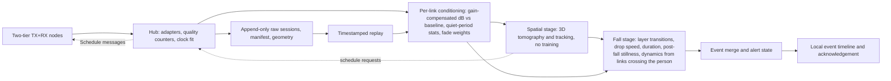

# Build plan: a room-installed possible-fall monitoring system

Planning date: 2026-10-19; architecture and processing updated 2026-10-20 after the [limits review](limits/README.md) (two-tier ESP32 mesh as primary, geometry-based spatial stage before fall classification, rich receivers optional). User clarified that there is no hard demo deadline; aim for progress as soon as practical toward the finalized project. The eight-week sequence below is an initial work estimate, not a completion promise or deadline. All dataset sizes, thresholds, and pass criteria below are proposed engineering targets. No fall performance has been measured for this team's hardware. [final-system.md](final-system.md) defines the finalized-system direction and additional operational acceptance work.

## 1. Deliverable and boundaries

Build a local system that continuously records fixed Wi-Fi links, assesses measurement quality, detects a possible fall in an installed room, and manages the event through acknowledgement and resolution. Support installation, restart/recovery, bounded storage, sensor-loss reporting and sustained unattended operation. Replay and live operation share the same inference pipeline. The main research contribution is a measured tradeoff between **new-room performance, installation/calibration effort, and false-alert burden**. One-room experiments are validation milestones toward the finished system.

Prioritize fall detection over the original five-stage presentation order. Motion and capture quality are prerequisites; general stationary occupancy, room-to-room identity, and counting are separate tasks. A quiet room must not automatically become an empty room. A second person must not silently disable the detector, and a count model must not be the only protection against untested multi-person conditions.

Initial supported envelope: one adult, one furnished room, fixed radio placement, specified coverage positions and fall types. Evaluate staged events under a supervised, suitable protocol; use existing datasets while organizing that protocol. Natural elderly falls, arbitrary homes, bathrooms through multiple walls, and reliable multi-person fall attribution are not established by a capstone demonstration.

## 2. Hardware decision

**Work now (updated 2026-10-20):** build on the original ESP32. For falls, the measured ESP32 gap is sample rate, export and coverage, which are engineering problems; bandwidth and phase coherence did not limit any fall result, and the rich-receiver fall systems still lost accuracy in new rooms ([paper audit](limits/paper-audit.md)). Prior two-board ESP32 capture logs exist; confirm current board count and firmware. The roughly 70 Hz saved rate matches the 921,600-baud serial ceiling; see [local evidence](local-evidence.md). Buy 2–4 ESP32-C5s for a same-link comparison (original ESP32 at 2.4 GHz vs C5 at 2.4 and 5 GHz) before buying the 16–24-node fleet. If the C5's 5 GHz does not clearly separate falls from fast sitting, use original-ESP32 Ethernet/PoE boards.

**Optional rich-RX reference (previously the option 1 candidate):** bring one in only if the single-link sample-rate test shows fall/fast-sit confusion that higher rates fix. a native Linux host with AX210NGW + FeitCSI, receiving a compatible embedded transmitter. Prove actual frame/PHY compatibility before adopting this pairing. NXP or an exact CSI-capable router remain alternatives. The previously suggested matched Linux TX/RX pair is a controlled acquisition reference only; it does not satisfy the current embedded-TX deployment constraint. Prefer borrowed lab PCs where convenient, but buying suitable compute is in scope. Select compact deployment hardware after predictive performance, stability and driver maintenance are measured. This is a capture proposal, not evidence that AX210 achieves Intel-5300 paper accuracy.

**New-hardware selection is unrestricted by current inventory:** if a rich-RX reference is needed, also evaluate the exact NXP 88W8997 acquisition bundle because it has stronger fall-specific precedent in the supplied research. AX210 remains the practical default if NXP's host/BSP/CSI tooling cannot be obtained promptly. Buying suitable hosts, radios, antennas and additional receivers is in scope; borrowing is a convenience. See [final-system.md](final-system.md) for the acquisition decision and final operational requirements.

Use fixed compatible band/PHY settings for each acquisition baseline; original ESP32 sensing TX requires 2.4 GHz. ESP32-C5 nodes provide a 5 GHz comparison on the same embedded architecture (HT20/HT40 CSI on both bands). At 5 GHz the same fall speed needs about 2.25× the per-link sample rate, and each link's sensitive zone is narrower. Test wider bandwidth and other rates only after a stable baseline. Compare hardware within the same band/configuration where possible. If ESP32 is tested at 2.4 GHz and AX210 at 5 GHz, call it a complete-system comparison: it does not isolate chipset quality. Do not transplant a 3-receive-chain Intel 5300 tensor or weights directly onto a 2-chain AX210.

**Coverage (updated 2026-10-20):** use one TX and one RX for bench work only. The sensing architecture is a two-tier mesh: every node transmits broadcast probes in turn and captures its peers. Proposed starting geometry, to be validated:

- 16–24 nodes for a 20–30 m² room, spaced about 1 m around the perimeter (successful RSS tomography used 24–34 nodes at 0.6–1.1 m).
- A floor tier at about 0.3 m and an upper tier at about 1.4 m or in the ceiling corners (2–2.4 m). The cross-tier diagonal links were essential to separating lying on the floor from crouching in [Mager et al. 2013](https://span.ece.utah.edu/uploads/mager-pimrc2013.pdf).
- Antennas at least 5 cm off walls and away from metal.

Find the minimum node count from offline link subsets of a full recording, then confirm it live. Compare against the best single link and late voting at the same false-alert budget. Keep raw inter-device phase separate.

No generic OpenWrt purchase is required. The MacBook reference means built-in Wi-Fi; no supported capture path for that radio under macOS was established in the inspected toolchains. Use it as development/analysis/UI compute, with dedicated CSI capture nodes. Full alternatives, procurement conditions, and estimated budgets are in [hardware.md](hardware.md).

## 3. Software architecture

**Current implementation contract:** one Rust Cargo workspace; sensing TX is embedded; sensing RX can run embedded with `no_std` or on Linux with `std`; all scientific signal processing and ML run on Linux with an OS. An embedded receiver only captures, timestamps, buffers and exports native CSI plus metadata. [rust-workspace.md](rust-workspace.md) specifies the package tree, TX/RX/TX+RX entrypoints, radio ownership, contracts and build order. It supersedes the earlier Python-first acquisition proposal.

Support both experiments through the same acquisition contracts:

| Candidate | Sensing and export | Processing |
| --- | --- | --- |
| Option 1: TX star (comparison) | Multiple embedded TX → one supported Linux CSI RX, or a CSI-capable router exporting to Linux | Rust ingest/recording → Python DSP/ML on Linux |
| Option 2: distributed TX+RX (primary) | Two-tier embedded nodes take TX turns, capture peers' CSI and export it over wired links; a compatible Linux sensing RX may contribute additional links | Same Rust ingest/recording → Python DSP/ML on Linux |

The Linux hub need not transmit sensing probes. If its own TX role is explored, treat that as an optional extension to the embedded-TX baseline. Measurement export uses ordinary network transmission independently of the sensing role. Full mesh versus selected links is an experimental configuration, not a separate software product.

Support [configurable CSI export batching](rust-workspace.md#csi-export-batching-configurable-initially-500-ms), initially up to 500 ms with earlier byte/sample-cap flushes. Keep capture timestamps/rate independent of export cadence. Measure whether reduced transport overhead improves usable observations without excessive burst gaps, memory pressure or event-to-alert delay.

The dashed loop is adaptive scheduling: transmitters run at a low background rate (about 10 Hz each for tomography), and the hub boosts the transmitters whose links cross the tracked person (about 200–300 Hz) within its airtime budget. The per-link FallDeFi, FallAware and ENetFall pipelines remain as baselines on the same conditioned data.

Implement acquisition/transport/recording in Rust and science in Python. Begin with saved-data replay and a short-batch SDK so teammates can work without radios; the MacBook can develop/replay, while the deployment processing service runs on Linux. The `tx-node`, `rx-node` and `txrx-node` entrypoint crates are thin wrappers over shared embedded code; `csi-hub` supplies the OS-based RX/collector entrypoint. TX+RX shares one half-duplex radio runtime. Use a small PyTorch model and benchmark CPU inference before allocating a GPU or Jetson. A local or cloud Linux host can run the same processor; processor placement is separate from sensing topology.

Proposed modules, to create during implementation:

| Module | Contract and useful check |
| --- | --- |
| Rust `csi-protocol`, `csi-linux` and host adapters | ESP32 and FeitCSI records become a versioned sample with device/link identity, local/host time, sequence semantics, PHY/layout, raw IQ, RSSI and quality flags. Reject incompatible layouts; preserve raw bytes. |
| Rust `csi-node` / `csi-host` health | Track sender attempts, receive callbacks, queue drops, export drops, interarrival percentiles and reconnects. Unknown measurement quality becomes explicit unavailable output. |
| Rust `csi-host` sessions/replay | Immutable raw capture + manifest + separate event labels + split assignment. Content hashes identify artifacts. Preserve provenance and upstream licenses. |
| Python `processing/stream` | A trailing 3–5 s window, initially advanced every 0.25–0.5 s; measured timestamps (clock-fit mapped), bounded short-gap handling and explicit invalid windows. No future data or offline full-record smoothing. |
| `conditioning` | Per link: gain-compensated per-subcarrier dB relative to the empty-room baseline, quiet-period Z-scores, fade-level weights. Baseline updates only on links no tracked person explains, frozen during an active fall event. Normalizing away absolute level is not allowed on the stationary path. |
| `spatial` | Regularized 3D tomography from the installation geometry (link ellipses per tier and across tiers) at about 10 Hz; tracker that holds a still person; quiet links count as evidence of empty space. Outputs position, occupied height layer and motion energy, and sends schedule requests to the hub. No training. |
| `features` | From the spatial stage: layer transitions, drop speed, duration and post-fall stillness. From the links crossing the person's position: short-time energy, autocorrelation and spectral features. Per-link amplitude/spectral features remain for the baselines. Treat physical-speed estimates as unverified until their model assumptions hold. |
| `models` | Small feature classifier or HMM on the room-independent features; the per-link baselines and a small 1D CNN/TCN for comparison, with separate input adapters for hardware. Same manifest and splits for every comparison; never concatenate all links' features into one input. |
| `commissioning` | Node-position survey (tape measure; ~5–10 cm accuracy is our estimate of what the model needs), empty-room baseline and fade levels, coverage check of crossing links per floor cell at both tiers, walk test. Produces a versioned geometry file and a pass/fail result. |
| `events` | Frozen thresholds, candidate merge, duplicate suppression and alert lifecycle. Retain every candidate and suppression reason for evaluation. |
| `evaluation` | Session-level split validation; one-to-one event matching; sensitivity, distinct alerts/day, delay, quality availability and per-room breakdowns. |
| `app` | Room state, link health, possible-fall timeline, acknowledgement and sensor-loss indication. Display uncertain states plainly; no unsupported medical certainty. |

Reuse existing serial capture/parser and reproducibility patterns. Do not rename the heartbeat spectral heuristic into a fall detector. See [local-evidence.md](local-evidence.md) for current code paths.

## 4. First 14 working days

Start the no-hardware Rust work with the contract, legacy recording adapter and deterministic replay in [the workspace implementation order](rust-workspace.md#implementation-order-and-acceptance-evidence). Create hardware-dependent packages as their backends are validated. ML work can consume replay immediately. The schedule below describes evidence gates, not a reason to wait for procurement before implementing these host components.

| Days | Work and owner role | Evidence to finish |
| --- | --- | --- |
| 1–2 | Embedded + data: board/chip inventory, reproduce capture, instrument sender/callback/export counters; inventory available native Linux PCs. ML: verify public dataset access and labels. | One configuration manifest; known packet source; raw files; measured rates/gaps; exact upstream revisions; public-data provenance notes. |
| 3–4 | Embedded: test compact export/queueing against current text format; avoid long callback processing. Data: record empty, stationary, walking, rapid sitting and lying down at several room positions. | Separate 30-minute stable runs, restarts, quality report, position map and evidence that rate improvements represent additional unique observations. |
| 5 | Team checkpoint: single-link sample-rate test (≥300 Hz captured, downsampled offline), gain readout/forcing result, RSSI fix; start the ESP32 vs ESP32-C5 same-link comparison. | Capture quality and fall-like/fast-sit separability by rate and board. Unreliable data cannot be repaired by a larger model. |
| 6–8 | Data + ML: implement shared replay, conditioning, feature baseline and leakage checks. Embedded: bring up an 8-node single-tier mesh with clock alignment from shared probes. | Reproducible ordinary-activity baseline; entirely held-out sessions; no shared event/window across splits; first tomography tracks; no claimed fall performance from ADLs. |
| 9–10 | Data: collect first controlled fall/fall-like pilot if the protocol is ready; otherwise continue public-data reproduction and local non-fall recordings. | Balanced per-person/position activity schedule, event start/end labels, later-day test, failure cases. |
| 11–12 | ML: compare compact CNN/TCN to feature model on identical split. Product: replay candidate events through local alert UI. | Threshold chosen on validation data; event-level results; measured observation + processing delay. |
| 13–14 | Team: move to a new room and test zero-shot vs separately recorded ordinary-activity calibration. | First adaptation curve, known failures and a written continue/change-sensor/narrow-scope decision. |

Parallel roles describe workstreams, not named teammates or assumed staffing. Procurement and participant logistics can extend elapsed time.

## 5. Remaining milestones

| Stage | Typical window | Exit evidence |
| --- | --- | --- |
| Stable capture and baseline | Weeks 1–2 | Above sprint outputs and a recorded hardware decision. |
| One-room event detector | Weeks 3–4 | Safe staged falls + hard negatives, unseen participant/day, coverage map, event metrics and real-time replay agreement. |
| Transfer and adaptation experiment | Weeks 4–6 | At least three rooms with one held out at a time; separate calibration/evaluation sessions; held-out people where feasible; furniture-change test. |
| Sustained operation | Weeks 5–7, overlapping | At least 72 observed non-fall room-hours for engineering triage, then extend toward several room-weeks; documented outage time and alarm review. |
| Integrated system and report | Initial checkpoint around week 8 | Frozen candidate model/configuration, setup instructions, live/replay operation and results by condition; continue operational qualification against final-system requirements. |

Use evidence gates to control scope: establish one-room reliability and cross-room/adaptation results before counting and identity tracking. Extend people/rooms/days and continuous recording when uncertainty remains. Completion is defined by the agreed system requirements, not reaching a demo date.

## 6. Dataset that supports the claim

Pilot proposal: three participants, one room, 10 carefully defined activity types and five repetitions each gives 150 staged events. This is an engineering pilot, not evidence of generalization. Include multiple fall directions only under the agreed protocol and ordinary confusers such as fast sitting, deliberate lying down, kneeling, bending, transfers and object/door motion.

Larger feasible target: six participants × three rooms × 10 activity types × five repetitions = 900 staged events, about 450 if half the types are falls. Add later-day and moved-furniture sessions as separate domains. Prefer more independent people/days/rooms over thousands of overlapping windows. Record action order in balanced/randomized blocks so label is not correlated with room, timestamp, battery level or radio mode. Sample size must be revised around safe collection capacity.

Label absolute event start/end, impact/end of descent when meaningful, recovery, activity class, participant pseudonym, room, layout version, position and direction. Add a label-confidence flag. Keep temporary annotation video and any participant mapping outside the repository. Use ordinary activities for partner-site data initially. Slow slides, assisted transfers and simultaneous people need their own coverage; do not fold them into a single headline score.

Public data can establish a training/evaluation pipeline, but cannot replace own-hardware recordings. Check whether public metadata actually supports participant/session splits before claiming a strict replication. If it does not, document the missing split and use the dataset for algorithm development only.

## 7. Model and calibration experiment

**Primary candidate (2026-10-20):** the three-stage pipeline above (conditioning, spatial stage, fall stage on room-independent features). Its claim to test is that it holds up in held-out rooms better than per-link classifiers at the same false-alert budget.

Use the historical methods as concrete baselines: FallDeFi-inspired amplitude/spectral features + SVM/RF; FreeFall-inspired activity splitting and temporal shape features; FallAware-inspired autocorrelation + small LSTM/TCN; and ENetFall's native-data EfficientNet reproduction. The latter is a reference reproduction, not a reason to add arbitrary model complexity. Document which source steps are faithfully reproduced versus changed for our capture hardware. Compare on identical held-out groups, then add variants only for a measured failure. [evidence-to-design.md](evidence-to-design.md) ties each choice to the Drive sections and their demonstrated limitations.

Run four installation conditions on each held-out room:

1. **Zero target adaptation:** source-trained model; only radio/quality installation checks. Freeze source normalization and threshold.
2. **2 minutes known-empty:** calibrate permitted normalization/noise statistics, the conditioning baseline and fade levels using a separate target recording, plus the node-position survey the spatial stage needs. No fall labels and no claim of classifier fine-tuning.
3. **5 minutes ordinary activities:** known-empty, walking, sitting, standing and deliberate lying down. Compare threshold adjustment versus a constrained model-head update with source-data replay. Record the exact activities and calibration burden.
4. **10 minutes ordinary activities:** same protocol with more coverage; compare whether the extra effort helps. If more labeled falls are needed, report that as a separate supervised adaptation condition, not quick normal-use onboarding.

Ordinary-activity adaptation alone does not teach the appearance of target-room falls. Keep a pretrained source fall classifier and evaluate both recall loss and false-alert change after adaptation. Normalize responsibly: removing every absolute/slow component may suppress useful posture/slow-fall evidence. Re-estimating an empty reference while somebody is motionless can erase the person.

The proposed comparison must separate room shifts from participant shifts where possible. Do not tune the best adaptation method repeatedly on the final held-out room. Choose the method in development domains, freeze it, then evaluate one-time calibration and later sessions in the test domain. Further details and paper evidence are in [generalization.md](generalization.md).

## 8. Event policy, metrics and go/no-go rules

Start with provisional targets of ≥90% staged-event sensitivity, ≤10 s 95th-percentile event-to-alert delay, ≥95% valid observation time, and ≤1 distinct false alert per observed room-day for an early demonstration. These are gates to aim for, not clinical acceptance criteria or measured results. Display confidence intervals and event counts. Evaluate latency from an explicit event timestamp; inference runtime alone excludes observation and smoothing delays.

Define one-to-one event matching, candidate-window merge and duplicate suppression before scoring. Report event sensitivity across *all* scheduled falls, including events during quality failure, alongside sensitivity restricted to valid sensing. Report unavailable time separately. A coverage/quality filter must not inflate sensitivity by removing difficult examples. Background motion after a possible fall must not silently cancel it; retain it unless there is explicit acknowledgement or an evaluated cancellation policy.

Report false alerts per actual monitored room-hour/day, by activity and room. Maintain a second calendar-time availability figure; outages must not make an alert rate look better. With zero false alerts in T observed days, the one-sided 95% Poisson upper rate is approximately 3/T per day: three clean days only bounds the rate near one/day; showing a bound near one/month requires about 90 observed days under that model. Correlated days and domain diversity further limit the inference. A short demo cannot establish a care-home alarm burden.

Decision rules:

- If the ESP32 exporter cannot sustain its intended rate, fix transport and callback work before blaming radio capability or training a CNN.
- If motion is weak at important locations, adjust mounting or add nodes where the coverage check shows fewer than three crossing links, before increasing model complexity.
- If the single-link sample-rate test shows falls confused with fast sitting in a way that higher rates fix, bring in a rich-RX reference (NXP or AX210) rather than tuning models.
- If the spatial-stage pipeline does not beat the best single link and late voting in held-out rooms, report that and keep the simplest configuration that matches it.
- If richer capture improves new-person/day results materially at the same alert budget, keep it even if ESP32 is cheaper.
- If new-room performance improves only after labeled target falls, narrow the deployment claim and quantify that burden.
- If ordinary-activity calibration reduces false alerts but reduces fall recall, reject that adaptation configuration.
- If two people or slow falls remain unobservable, expose the limitation and compare a different sensor rather than inventing count/phase information.
- If neither Wi-Fi branch approaches the agreed sensitivity/alert budget after controlled capture and data work, pivot the accuracy-critical sensing task to a depth-resolving modality. The optional radar comparison below is a concrete candidate.

## 9. Sensor contingency when fall accuracy is the governing requirement

If Wi-Fi CSI is a hard course constraint, keep the deliverable as a bounded sensing research prototype. If the priority is the most credible contactless fall system regardless of radio, evaluate a TI IWR6843AOPEVM radar demo alongside Wi-Fi before spending weeks on architecture tuning. TI explicitly points to a fall-detection demo for this device in its [healthcare application note](https://www.ti.com/lit/an/swra810/swra810.pdf). This establishes an available development route, not a proven elderly-fall performance advantage.

The [IWR6843AOPEVM product page](https://www.ti.com/tool/IWR6843AOPEVM) provides point-cloud access over USB and integrates 3 TX/4 RX antennas. A DCA1000 adds raw-data access; it is not necessary merely to consume the board's point clouds. Verify the exact demo/toolbox version and host operating-system support before procurement. Compare per-room coverage, obscured bodies, seated/lying positions, false alerts, adaptation effort and installation cost on the same activities. Radar still requires validation; adding it creates a separate experiment and must not be presented as CSI-only accuracy.

## 10. Decisions still open

Confirmed: no hard demo deadline; finalized-project quality is the objective; original ESP32 family; MacBook built-in Wi-Fi. Budget, current board count, available native Linux hosts, participant/protocol logistics, target room access, and the partner's acceptable alert burden remain unknown. They affect purchasing and collection size. They do not block capture auditing, public-code inspection, a versioned data format, or the first ordinary-activity experiments.
