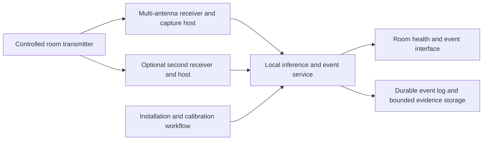

# Finalized project: system direction and hardware selection

Updated 2026-10-19 following the team's clarifications. This document governs the project direction; the smaller experiments in the build plan are evidence-producing milestones.

The historical Drive research is the technical foundation. [evidence-to-design.md](evidence-to-design.md) maps FallDeFi/FreeFall, ENetFall, FallAware, SHARP and the context/counting work to specific implementation choices. Current extraction-tool availability is a separate engineering constraint; AX210 convenience alone does not establish superior fall sensing or override the papers' measurement requirements.

## Confirmed constraints

- The objective is a finalized working project, with progress as soon as practical and no hard demo deadline.
- New hardware can be purchased. Do not constrain the architecture to equipment currently owned or require the ESP32 to fail before evaluating better hardware.
- Existing equipment includes original ESP32 hardware and a MacBook with built-in Wi-Fi. The exact live board count is not confirmed by old two-board recordings.
- Implement one Rust workspace. Sensing TX is embedded; RX may be embedded `no_std` or Linux `std`. Embedded nodes capture/export with lightweight bookkeeping; all scientific DSP, fusion and ML run on a Linux machine with an OS. [rust-workspace.md](rust-workspace.md) defines the structure.
- Accurate fall detection is the primary task. Counting and room context remain useful extensions. Room/layout robustness and short ordinary-activity calibration are central research questions.

The MacBook can support development, training, analysis and the interface. No supported native macOS/built-in-MacBook CSI extraction route was established in the inspected [Nexmon CSI support table](https://github.com/seemoo-lab/nexmon_csi) or [FeitCSI requirements](https://feitcsi.kuskosoft.com/getting_started/). Plan dedicated capture hardware; this is not a universal claim that every MacBook chipset is incapable of research modification.

## Hardware decision: invest in measurement quality first

Current deployment candidates are embedded TX → Linux RX (option 1), and embedded TX+RX nodes exporting to Linux (option 2). Richer receiver candidates below remain relevant, but a matched pair of Linux transmit/receive hosts is now only a controlled acquisition reference; it does not meet the embedded sensing-TX baseline. Validate embedded frame compatibility before selecting a rich RX. A Linux hub can collect without a sensing radio.

**Recommended immediate direction:** a controlled transmitter and a multi-antenna CSI receiver using dedicated, fixed hardware. Establish one complete acquisition link, then compare one receiver against two spatially separated receivers for coverage. Multiple receive chains within a radio and multiple receiver locations are complementary. Each Linux PCIe receiver requires a compatible host; a central logging hub does not eliminate those hosts.

Do not freeze the final bill of materials from a paper's accuracy number. Select between these two serious Wi-Fi acquisition candidates:

| Candidate | Why evaluate it | Procurement/selection gate |
| --- | --- | --- |
| **NXP 88W8997 with an exact supported host/BSP** | Closest hardware lineage to FallAware and much of CSI-Bench's fall data. Stronger task-specific precedent than choosing a radio solely because capture code exists. | Obtain the actual module/EVK, compatible host, antennas, BSP, CSI driver/firmware and `mlancsi` package. Verify access/terms and capture format, rate and sustained stability before ordering a fleet. Public documentation is not confirmation of a turnkey replica of the papers' stack. |
| **Intel AX210NGW + FeitCSI Linux receiver; matched pair as reference** | Explicit public extraction/injection toolchain, two receive chains, configurable PHY and bandwidth, controllable packet source. This is the current practical default for development if NXP's exact chain cannot be secured promptly. | Verify PCIe host compatibility and a reproducible driver/kernel combination. A matched reference pair means two radios and compatible hosts; deployment instead requires proof with the embedded TX; no assumption that the MacBook or an arbitrary USB adapter can host them. Own-hardware fall data are required. |

NXP's [AN14011](https://www.nxp.com.cn/docs/en/application-note/AN14011.pdf) documents CSI support and acquisition tooling; the detailed availability caveats are in [repositories.md](repositories.md#nxp-acquisition-a-real-lead-still-a-procurement-gate). AX210 requirements and source revisions are in [hardware.md](hardware.md). Neither platform has measured fall accuracy for this project.

**Hardware acquisition sequence:**

1. Secure a complete NXP capture bundle or verify precisely what is missing, while identifying compatible Linux hosts for the AX210 option. This is an acquisition decision, not an ESP32 experiment dependency.
2. Acquire/borrow one complete richer TX–RX chain, matched antennas, mounts and Ethernet backhaul. If both platforms are readily accessible, a direct acquisition comparison is worthwhile; do not create two full software products.
3. Freeze band, bandwidth, packet source, rate and logging format; map signal quality and event separability across the room. Keep raw metadata and measure export losses independently of receive losses.
4. Add a second receiver when testing the intended room architecture. Keep it only if it measurably improves weak-location sensitivity or false alerts; account for its host, power and installation burden.
5. After predictive and operational evidence, choose compact headless deployment nodes using the validated radio/toolchain. Re-test after changes in host, driver, antennas or placement. Research laptops are a development convenience, not a mandatory finished installation.

The original ESP32 is an optional low-cost baseline or a compatible traffic-source experiment. It is not the presumed final receiver. A newer single-chain ESP32, generic OpenWrt router, or higher packet-rate setting is not automatically an improvement over a supported multi-antenna stack.

If the team is free to choose any contactless sensing modality, evaluate the documented TI radar path early on the same activities, rather than reserving it for the end. If Wi-Fi CSI itself is a project requirement, keep radar as a comparison or explicit scope change. No radar superiority or combined-sensor accuracy is established by the current research.

## Intended installed architecture

The team's multiple-ESP32-TX/single-rich-RX proposal is a candidate for this architecture. [node-topology.md](node-topology.md) compares it with distributed RX and room-local links. The proposed [all-node TX/RX experiment](experiment-sensing-mesh.md) compares higher per-link temporal sampling against additional perspectives, with a central processor that may be local or cloud-hosted. CSI capture location and compute location are independent choices. The processor runs Linux with an OS; local versus cloud placement and final sensing topology remain open. Thin firmware role entrypoints and common measurement contracts support both experiments without moving scientific processing onto MCU nodes.

Proposed configuration: room-specific fixed sensing links, a local service that performs inference and manages events, and a caregiver-facing interface. Begin with one room; extend through independently commissioned rooms. Do not assume one transmitter will illuminate an entire facility reliably.

Use Ethernet/USB backhaul where practical to avoid competing with sensing traffic, and measure wireless export overhead where used. Fuse per-link features or scores with timing/quality masks; do not treat independent receivers as phase-coherent antennas. Headless capture and inference should restart automatically. Local versus cloud inference remains open: evaluate upload latency, bounded buffering, recovery and unavailable decision time during internet outages before selecting processor placement.

## Finished-system behavior

| Area | Required behavior and evidence |
| --- | --- |
| Installation | Document mounts, room coverage, radio settings and supported configurations. Run known-empty and ordinary-activity checks, record calibration duration and issue a clear pass/fail commissioning result. No resident falls required for setup. |
| Detection | Compare feature and temporal models; retain cross-room evaluation and slow/low-height fall strata. Publish tested coverage and unsupported conditions. A motion-only trigger is not sufficient. |
| Adaptation | Compare frozen source model to 2/5/10-minute calibration/adaptation on later target sessions. Preserve source fall knowledge; evaluate negative transfer. Version calibration with the model and installation geometry. |
| Events | Maintain candidate → possible fall → acknowledged → resolved state with durable IDs and timestamps. Persist pending events across restart. Later motion alone must not erase an event. |
| Delivery | Distinguish event creation, delivery and acknowledgement. Display failures and retry boundedly; deduplicate by event ID. Define the intended notification channel with the partner before integration. |
| Sensor health | Report stale capture, missing receiver, clock resets, excessive gaps and drift. “Unavailable” is distinct from empty, stationary or no fall. Measure time without usable sensing. |
| Recovery | Inject transmitter, receiver, service and network restarts. Confirm reconnection, window warm-up, calibration retention and pending-event preservation. Document behavior during power loss; add backup power only if required by the agreed uptime target. |
| Storage | Keep durable event records and bounded raw evidence around events; rotate routine buffers. Use access controls and explicit retention for sensitive room-activity data. Keep consenting research ground truth separate from deployed inputs. |
| Updates | Pin radio firmware/driver/kernel, model and calibration versions. Verify update rollback and replay comparisons before replacing a working configuration. |
| Evaluation | Report all scheduled fall events, distinct false alerts/observed day, latency, coverage and intended-time availability. Include outages and ordinary daily use, not only centered activity clips. |

These are proposed engineering requirements to implement and verify. They are not claims that the current demo or upstream repositories already provide them.

## What makes the project complete

Agree numerical acceptance criteria with the care partner and supervisor, then require evidence in four areas:

1. **Predictive value:** useful event recall and manageable false alerts across independent people, rooms, days, furniture changes and confusable activities. Clearly distinguish evaluated single-person use from multi-person stress tests.
2. **Installation practicality:** an actual person can install and calibrate it with documented steps, measured time and no staged falls. A model that requires target-room fall training changes the deployment proposition.
3. **Operational reliability:** unattended recording/inference, visible health failures, durable event handling, restart recovery and bounded storage. Demonstrate fault behavior deliberately.
4. **Reproducibility:** another team member can provision the supported hardware, replay a labeled recording and reproduce predictions and metrics using frozen artifacts.

The earlier ≥90% staged sensitivity, ≤10 s p95 alert delay, ≥95% valid observation time and ≤1 false alert/day are initial learning milestones only. They are not settled final-system acceptance levels. Additional calendar time should buy independent evidence and reliability work, not an unlimited sequence of model variations. A working demonstration can occur whenever these components first connect; the finished project follows the agreed acceptance evidence.

Budget and host availability still affect which exact bundle to acquire, but do not constrain the design to existing equipment. No purchase or hardware modification is performed by these planning updates.
