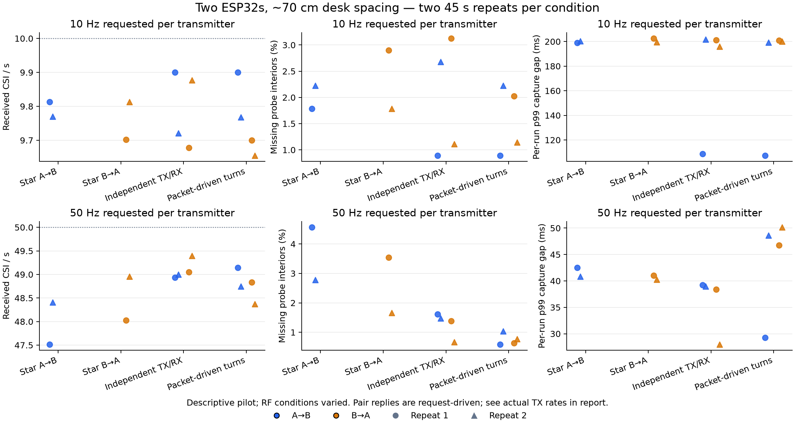

# ESP32 acquisition mode comparison

Completed **16 trials × 45 s**, two repeats of eight mode/rate configurations, producing **31,482 CSI captures**. The user reports two ESP-WROOM-32 boards about 70 cm apart on a desk, roughly in the same plane. Room activity was not labelled or controlled. These measurements compare acquisition behavior, not sensing accuracy.

Both boards are now flashed and verified in **packet-driven pair mode with a 50 Hz target**, firmware 0.2.2. They continue transmitting/capturing while powered; the recorder has stopped and released the ports. The final 30 s check delivered 47.45 and47.69CSI/s, with no errors after the first second or queue/export drops. Mode/rate remains compile-time configuration, not a host runtime switch.

## What the measurements show

At a 50 Hz target, independent transmission had the highest and most even bidirectional sampling in this pilot. Packet-driven turns were close in throughput and showed lower interior sequence-loss fractions, but longer occasional gaps. Pair responders only send after receiving a valid leader request, and the pair offered slightly less traffic: lower conditional sequence loss alone does not prove better coverage or collision avoidance.

**There is no universal winner from these two desk repeats.** Keeping pair50 preserves the requested coordination design while delivering close to 50captures/s per direction. Independent50 is the stronger candidate when even sampling and minimum tail gaps are the immediate priority. More participants, repeated stable placements/RF conditions and labelled sensing trials are needed before choosing the full topology. Star supplies one sensing direction at a time here, so its total count is not comparable as the same coverage as two-way modes.

A=`a0:b7:65:dd:e9:3c` (`/dev/cu.usbserial-3`); B=`b0:b2:1c:0b:07:1c` (`/dev/cu.usbserial-0001`). Values below average two runs for each direction; loss pools their observed sequence interiors. Timing columns average per-run quantiles, not pooled quantiles.

| Mode/direction,50 Hz target | Actual TX requested/s | CSI/s | Missing interior | Mean run p99 gap | Worst observed gap |
| --- | ---: | ---: | ---: | ---: | ---: |
| Star A→B |49.80|47.96|3.67%|41.67 ms|63.74 ms|
| Star B→A |49.79|48.49|2.60%|40.63 ms|61.72 ms|
| Independent A→B |49.74|48.97|1.55%|39.10 ms|63.99 ms|
| Independent B→A |49.74|49.22|1.03%|33.18 ms|80.96 ms|
| Packet-driven A→B |49.33|48.95|0.81%|38.94 ms|113.79 ms|
| Packet-driven B→A |48.93|48.60|0.71%|48.45 ms|114.31 ms|

At 10 Hz targets, all modes averaged roughly 9.7–9.8CSI/s per observed direction; the two-way modes were very close and had no clear advantage. All repeated results, actual TX rates, RSSI and timing statistics are in [the detailed tables](results/README.md) and [machine-readable comparison](results/comparison.json).



Each dot/triangle is one45 s run. Blue is A→B; orange is B→A. No confidence interval or statistical superiority is implied. [SVG export](results/trial-comparison.svg).

## Controls and limitations

- Same source/version, channel 6, HT20/MCS0 longGI,64 byte over-air body, UART 921600, CSI configuration and awaited driver sends in all modes. Only TX/RX capabilities, turn policy and target interval differ. Pair tags fit inside the same body size. All received CSI had 256nativebytes, `first_word_invalid=true` and gain absent.
- Star A→B and B→A were measured separately. Independent mode enabled both TX/RX capabilities with independent periodic sends. Pair mode enabled both capabilities with exact-round request/response and adaptive timeout, with no fixed guard.
- Rates 10 and 50 Hz were tested. The first sweep ran forward, the second in reverse order, with both nodes reflashed/restarted and 5 s settling before every trial. Two repetitions are descriptive, not room/person/day generalization.
- **RF conditions varied substantially:** star-A50mean RSSI changed from −70.8to −57.2 dBm between repeats; star-B50from −73.4to −57.5 dBm. Independent50also improved from about −65.5to −58.5 dBm; pair50stayedaround −58to −60 dBm. The observed loss ranking cannot be assigned solely to scheduling. Board positions were not moved by the agent, but no physical survey or activity labels establish unchanged surroundings.
- Missing-probe fractions cover sequence interiors only. TX requested/accepted rates use first-to-last counter reports; capture rates use first-to-last capture timestamps. Their windows differ slightly, so dividing these rates is not an exact packet-delivery probability. The responder's sequence advances only when it attempts a reply, excluding leader requests it never received. Driver acceptance is not proof of on-air delivery.
- Intervals use the receiver's node timestamps. No shared-clock residual was measured: two nodes cannot both receive a third-party shared probe. Unknown gain and invalid first words prevent ranking physical CSI quality from uncorrected amplitude variance. No fall, motion, presence or localization performance was tested.

## Integrity and health

All 16 trial sessions sealed with verified segment hashes and expected direction/role flags. Each board remained in one epoch per trial. There were **12 framing/decode errors, all within the first second of attachment; zero later**. Timing alone does not prove the cause, although attaching to a running byte stream can begin mid-frame. There were zero missing recorded frames/captures, queue/export drops, self-captures, source/probe mismatches, duplicates, late/stale probes or node-timestamp regressions. Maximum RX queue high-water mark was1 of 32. See [validation.json](validation.json).

The original full-flash backups remain verified and preserved in `../boards/`. Every profile flash checked the connected MAC against board/image metadata and verified written regions; 460800programming baud succeeded, with 115200fallback available. `firmware/flash-manifest.json` archives image/source hashes, build interval/capabilities and target/peer MACs. `main-before.rs`/`build-before.rs` preserve pre-comparison firmware source. `run-original.py` preserves the sweep runner before adding the selected-profile restoration option. Raw sessions, flash logs, hub logs and per-session audits remain alongside the report. `registry.json` lists the16planned trials separately from restoration checks.

## Repeat or switch profiles

From the repository root, with the temporary tool environment available:

```sh
/private/tmp/capstone-bench-tools/bin/python sensing/firmware/tools/run_comparison.py --bench sensing/bench/2026-10-21/mode-comparison --restore-only --restore-condition pair-50
```

This checks MACs/backup/image hashes, flashes/verifies both boards, settles 5 s, records a fresh 30 s verification session and updates the registry. Choose `independent-50`, `pair-10`, `independent-10`, `star-a-50` or other names in `profiles.json` to change configurations. Never run another serial monitor concurrently. The original full sweep requires a fresh bench/registry; its image-building recipe and [PLAN.md](PLAN.md) are archived here.

For a fresh ordinary recording from `sensing/`, choose a new output directory:

```sh
cargo run --release -p csi -- hub --config bench/2026-10-21/mode-comparison/hub.toml --out bench/2026-10-21/mode-comparison/trial-next-01 --seconds 60
```

Activity trials still need explicit empty/still/walking labels and controlled positions. Plot dependencies are pinned in `sensing/firmware/requirements-analysis.txt`; plotting does not modify recordings.
